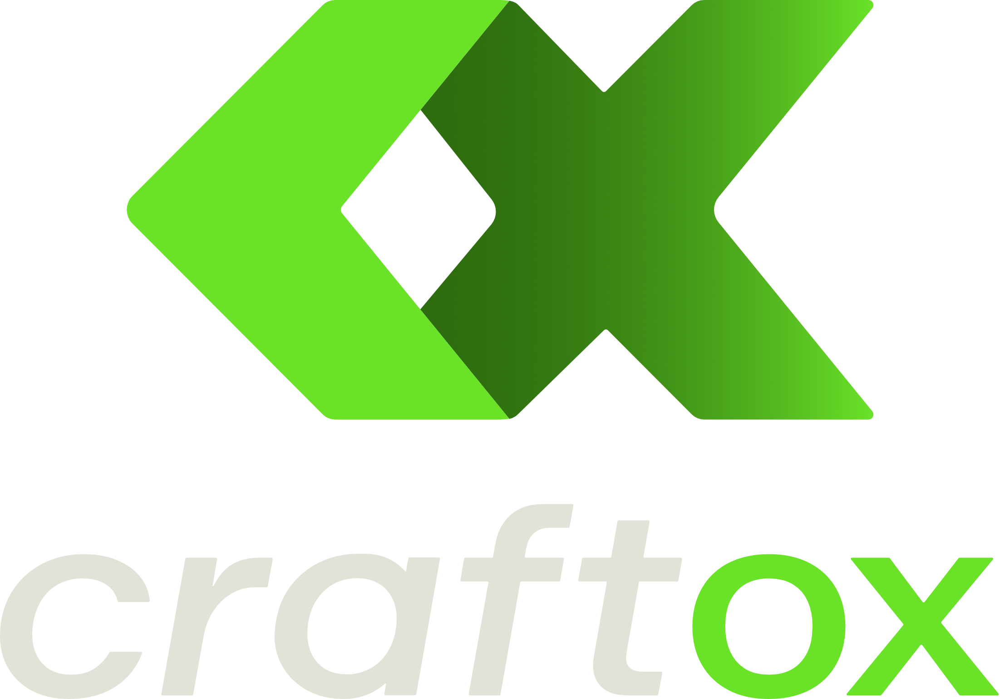

  
    
  
<strong>Focused solutions, crafted with care.</strong>

  
A small independent studio building focused, local-first software that respects your time and your data.

  

    <a href="https://craftox-labs.github.io"><strong>craftox-labs.github.io</strong></a>
  

---

### Currently crafting

**[davdart](https://github.com/craftox-labs/davdart)** — notes, tasks and events over CalDAV, local-first with sync. In early development.

[Source](https://github.com/craftox-labs/davdart)

More soon.

---

### Previously crafted

**[timedart](https://github.com/craftox-labs/timedart)** — local-first time tracking &amp; invoicing for people who bill by the hour.

[Website](https://timedart.app) · [Live demo](https://demo.timedart.app) · [Source](https://github.com/craftox-labs/timedart)

